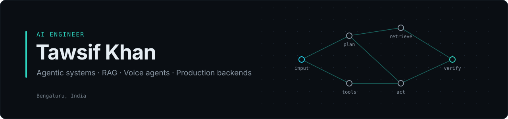
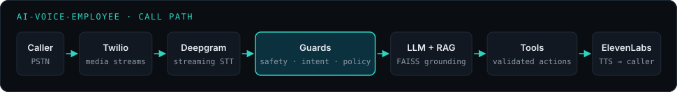
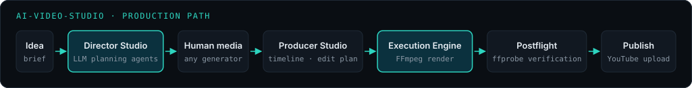
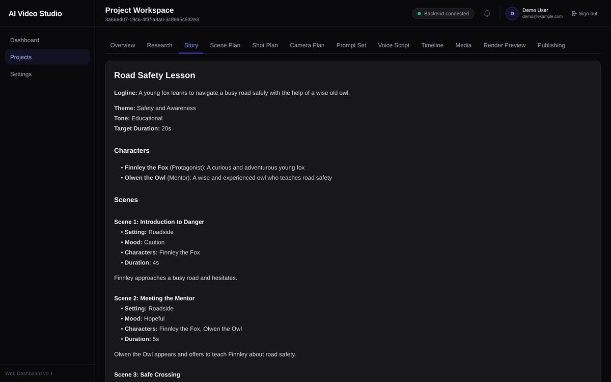
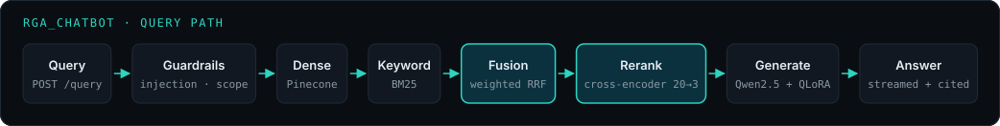

I build AI systems that have to work when no one is watching: voice agents that answer real phone calls, retrieval pipelines that cite their sources, and multi-agent workflows that turn a brief into a rendered, verified video. My focus is the engineering around the model, including deterministic guardrails, typed contracts between agents, evaluation, tracing and tests.

I'm based in Bengaluru and work at **Raaz MD**, a telehealth startup, where I've built internal automation agents (patient follow-up and AI-assisted blog generation). Those codebases are private. The projects below are public.

## Featured projects

### [ai-voice-employee](https://github.com/tawsif-raza/ai-voice-employee): AI phone agent for customer support

A real-time voice agent: Twilio Media Streams in, Deepgram streaming STT, then a conversation manager that runs **deterministic safety, intent and policy layers before the LLM ever answers**. Responses are grounded with FAISS retrieval. The model never calls tools directly; actions go through a validated orchestrator with verbal confirmation. A provider layer fails over from Claude to Gemini to Groq, and a QLoRA-tuned Qwen2.5-0.5B runs fully offline. Also includes OIDC auth, PII redaction, Postgres persistence with Alembic migrations, OpenTelemetry tracing, and CI running ruff, mypy and pytest across 50+ test modules.

`Python` `FastAPI` `Twilio` `Deepgram` `ElevenLabs` `Claude` `FAISS` `PEFT/QLoRA` `PostgreSQL` `OpenTelemetry`

### [ai-video-studio](https://github.com/tawsif-raza/ai-video-studio): multi-agent video production platform

Planning agents (research, story, scenes, shots, characters, environments, camera, prompts) exchange **typed Pydantic contracts with two-layer validation**. A deterministic producer turns their plan into an edit timeline, an FFmpeg engine renders it, and ffprobe postflight checks gate success, so "the process exited 0" is never mistaken for "the video is correct". The LLM layer fails over across OpenRouter, Gemini, OpenAI, Groq and Cerebras. Ships with a FastAPI backend streaming run events over SSE, a Next.js dashboard, a YouTube resumable-upload client, and 900+ tests.

Dashboard screenshot

 

`Python` `FastAPI` `Pydantic` `FFmpeg` `Gemini` `OpenRouter` `Next.js` `TypeScript` `PostgreSQL`

### [RGA_CHATBOT](https://github.com/tawsif-raza/RGA_CHATBOT): enterprise RAG with hybrid retrieval

Dense Pinecone retrieval plus BM25, fused with weighted reciprocal rank fusion and reranked by a cross-encoder, then answered by a QLoRA-tuned Qwen model with citations and streamed to a Next.js UI. On a 47-question held-out split, adding BM25 moved Context Recall@3 **from 8.5% to 12.8%** (4 → 6 questions) with about 10% of the corpus indexed. The evaluation write-up covers the conditions, confidence intervals, and why that ceiling is still low. Ingestion is idempotent and checkpointed and was run at 50k documents (about 300k vectors). Arize Phoenix traces every retrieval, rerank and generation step.

`Python` `FastAPI` `LangChain` `Pinecone` `BM25` `sentence-transformers` `Arize Phoenix` `Next.js`

<b>Also on GitHub</b>

- [highland-estate](https://github.com/tawsif-raza/highland-estate): Next.js 16 and React Three Fiber landing page for a coffee-estate resort, with time-of-day lighting and scroll-paced storytelling.
- [freshbliss](https://github.com/tawsif-raza/freshbliss): fruit-box e-commerce storefront on Next.js with a Firebase backend and CI.

## What I work with

| Area | Tools I've built with |
|---|---|
| LLM systems | RAG (dense, BM25, RRF, cross-encoder rerank), agent orchestration with typed contracts, LangChain, LangGraph, guardrails, multi-provider failover |
| Models | Hugging Face Transformers, PEFT/QLoRA fine-tuning (Qwen2.5), sentence-transformers, Claude, Gemini, OpenAI, Groq, OpenRouter |
| Voice | Twilio Media Streams, Deepgram STT, ElevenLabs TTS, barge-in handling |
| Backend | Python, FastAPI, Pydantic, SQLAlchemy, Alembic, PostgreSQL, SSE, WebSockets |
| Reliability | pytest, ruff, mypy, GitHub Actions, OpenTelemetry, Arize Phoenix, retries and circuit breakers |
| Delivery | Docker, Railway, Vercel, AWS, Next.js, TypeScript, Tailwind |

## How I build

1. **Solve the real problem.** Define it precisely before choosing a model or framework.
2. **Deterministic where it matters.** Safety, policy and validation are code and config, not prompts.
3. **Verify outputs, not processes.** A step succeeds when its result checks out.
4. **Measure honestly.** Report the number you got, with its method and its limits.
5. **Document the edges.** Say what the system doesn't do and where a human still steps in.

## Contact

[LinkedIn](https://www.linkedin.com/in/tawsif-khan-34952336b/) · [Email](mailto:tawsifk35@gmail.com)

Open to conversations about AI engineering, agentic systems and applied ML roles.
